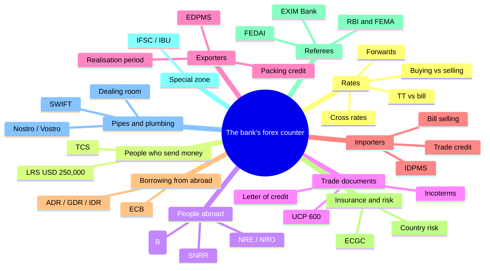

# Module A mind map: "The money crosses the counter"

The same layout in every Module A lesson and on the module PDF. Centre: the bank's forex counter. Ten branches,
always in the same clock positions so the learner remembers *where* a topic lives. Each lesson lights up its branch
and adds the nodes listed in its `map_nodes.md`. Lesson numbers follow `research/bfm/course_plan.md` v2.

| Clock | Branch | Syllabus unit | Lessons |
|---|---|---|---|
| 12 | **Rates**: buying/selling, TT/bill, cross rates, forwards | A1 | A01, A03–A06 |
| 1 | **People who send money**: LRS, TCS, other remittances | A2 | A16 |
| 2 | **People abroad**: NRE, NRO, FCNR(B), SNRR, NRI loans | A3 | A17–A18 |
| 3 | **Trade documents**: LC, UCP 600, URR 725, ISBP 745, Incoterms | A4 | A07–A10 |
| 4 | **Exporters**: packing credit, realisation, EDPMS | A5 | A11, A12, A14 |
| 5 | **Importers**: import finance, trade credit, IDPMS | A5 | A13 |
| 7 | **Borrowing from abroad**: ECB, ADR/GDR/IDR, FCCB | A6 | A19 |
| 8 | **Insurance and risk**: ECGC, country risk | A7 | A15 |
| 9 | **Referees**: RBI, FEMA, FEDAI, EXIM Bank, AD categories | A8 | A15, A21 |
| 10 | **Special zone**: IFSC, GIFT City, IBUs | A9 | A20 |
| 11 | **Pipes and plumbing**: Nostro/Vostro, SWIFT, SRVA, dealing room, technology | A3, A10 | A02, A21 (dealing room: C01) |

Colour code used everywhere in Module A: **green = the bank buys foreign currency** (lower rupee rate),
**red = the bank sells foreign currency** (higher rupee rate), **amber = reversing a deal** (crystallisation,
cancellation: the opposite side of the counter).
